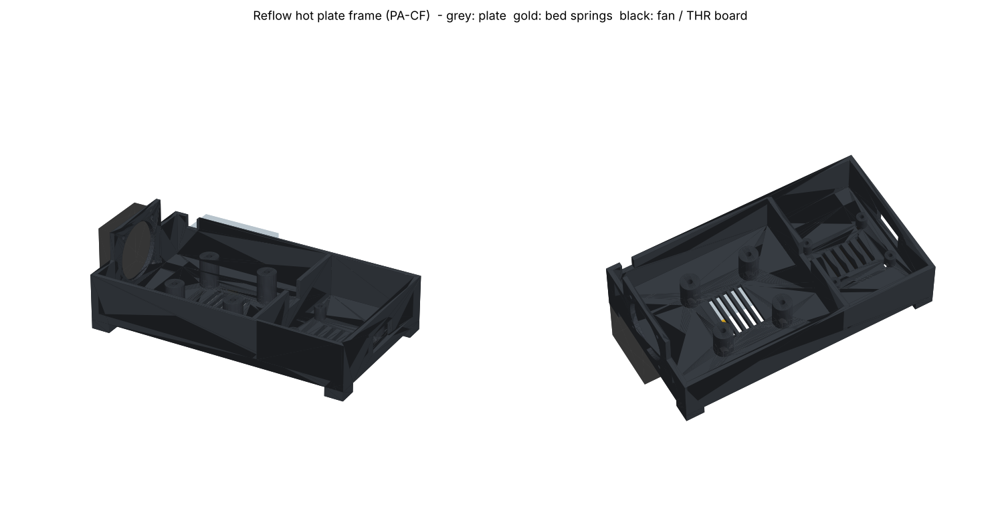

# Reflow Hot Plate (THR V2.0 + Klipper)

A $0 SMD reflow hot plate built from spare 3D-printer parts:
- **Controller:** Kingroon / Makerbase **THR V2.0** RP2040 toolhead board (heater MOSFET, NTC input, 2 fans)
- **Host:** Raspberry Pi Zero W running Klipper + Moonraker + Mainsail (WiFi)
- **Plate:** a de-finned aluminum heatsink, about 50x50x5 mm, heated by a stock 24V ceramic hotend heater
- **Frame:** parametric PA-CF print (`frame/hotplate_frame.py`)
- **MQTT:** Moonraker publishes plate temperature and state to Mosquitto, and reflow can be started over MQTT

## Repo layout
| Path | What |
|---|---|
| `firmware/klipper.uf2` | Prebuilt Klipper firmware for the THR (RP2040, USB, W25Q080 CLKDIV 2, no bootloader) |
| `firmware/klipper.config` | The menuconfig used to build it |
| `klipper/printer.cfg` | Board pins, heater, thermistor curve, fans, safety |
| `klipper/reflow.cfg` | `REFLOW`, `REFLOW_STOP`, `PLATE_HOLD`, `PID_TUNE_PLATE` macros |
| `klipper/moonraker_mqtt.conf` | MQTT block for moonraker.conf |
| `frame/hotplate_frame.py` | Parametric frame source. Edit PARAMS and run `python3 hotplate_frame.py` (needs `manifold3d trimesh numpy`) |
| `frame/hotplate_frame.stl` | Frame, ready to slice |

## Reflow profiles
| Profile | Preheat | Soak | Peak | Hold |
|---|---|---|---|---|
| `LEADFREE` (SAC305) | 150C at 90s | 185C at 180s | 245C at 230s | to 250s |
| `LEADED` (Sn63/Pb37) | 140C at 90s | 165C at 180s | 215C at 220s | to 240s |

If the plate falls more than 15C behind the curve, the profile clock pauses until it catches up. The run aborts if it takes far longer than expected, and the fan goes to 100% on any Klipper shutdown.

## Setup

## 1. Flash the THR board (from your PC, no 24V needed - uses the board's USB pads)
1. Solder a junk USB cable to the board's USB pads (standard USB colors):
   red -> 5V, black -> G, green -> D+, white -> D-
2. Hold the BOOT button, plug the USB into your PC, then let go.
3. A drive called RPI-RP2 shows up. Drag firmware/klipper.uf2 onto it.
4. It reboots by itself. Done.

## 2. Put Klipper on the Pi Zero W
1. Flash **Raspberry Pi OS Lite (32-bit)** with Raspberry Pi Imager. In the
   settings gear, set hostname `hotplate`, your WiFi, and turn on SSH.
2. SSH in (`ssh pi@hotplate.local`) and run:
       sudo apt update && sudo apt install -y git
       git clone https://github.com/dw-0/kiauh.git && ./kiauh/kiauh.sh
   Install -> Klipper, Moonraker, Mainsail. On a Zero it's slow - give it 20-30 min.
3. If Klipper later says the MCU version doesn't match, rebuild the firmware on
   the Pi: `cd ~/klipper && cp <repo>/firmware/klipper.config .config && make`
   then flash out/klipper.uf2 the same way.

## 3. Wire it for real use - splice the Kingroon THR cable
Cable colors (Kingroon): RED = 24V, BLACK = GND, GREEN = D-, YELLOW = D+
Verify first: set a multimeter to continuity and check that red beeps to the
"24V" pin on the back of the board. Red is 24V, NOT 5V - never tie it to USB red.

    THR cable RED    -> PSU +24V
    THR cable BLACK  -> PSU GND  AND  USB cable black (shared ground is a must)
    THR cable GREEN  -> USB cable white (D-)
    THR cable YELLOW -> USB cable green (D+)
    USB cable red (5V) -> tape it off, unused
USB end: cut an old **micro-USB phone cable** and splice it in place of the USB-A
cable. It plugs into the Zero's **USB** port (the inner one), not PWR. Power the
Zero itself from any 5V phone charger on the PWR port.
- Heater -> HE, thermistor -> TH, cooling fan -> FAN0
- Unsolder the USB pigtail from the pads after flashing, or at least cut its red wire

## 4. Upload the config
1. Open Mainsail (http://hotplate.local) -> Machine tab
2. Upload klipper/printer.cfg and klipper/reflow.cfg (overwrite printer.cfg)
3. On the Pi run:  ls /dev/serial/by-id/   and paste that line into
   printer.cfg where it says CHANGE_ME
4. Paste moonraker_mqtt.conf into moonraker.conf, then Restart Firmware

## 5. First run
1. Check that the temp reads room temp (~20-25C). If it shows junk, stop
   and check the thermistor plug.
2. PLATE_HOLD TEMP=60  -> confirm the plate heats and the temp climbs
3. PID_TUNE_PLATE  -> wait about 10 min -> SAVE_CONFIG
4. Do a test REFLOW PROFILE=LEADED with no board on it and watch the graph

## Commands
    REFLOW                  lead-free, peak 245C
    REFLOW PROFILE=LEADED   leaded, peak 215C
    REFLOW_STOP             abort - heater off, fan on
    PLATE_HOLD TEMP=150     hold any temp up to 250

## Credits
Pins and thermistor curve from Makerbase's official
[MKS-THR36-THR42-UTC](https://github.com/makerbase-mks/MKS-THR36-THR42-UTC) config.
Firmware is [Klipper](https://github.com/Klipper3d/klipper) (GPLv3).

## Safety
This heats metal to 250C off a 24V supply. Don't leave it running unattended, keep plastic away from the plate, and use it somewhere ventilated (flux fumes).
